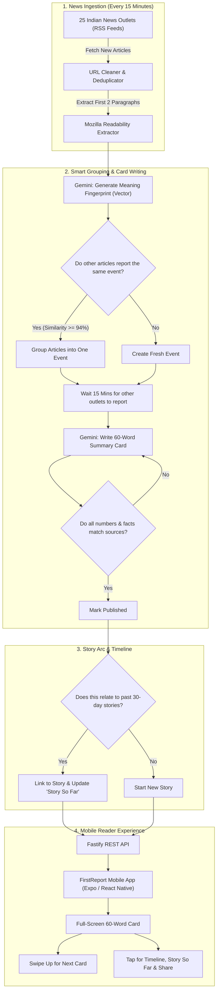
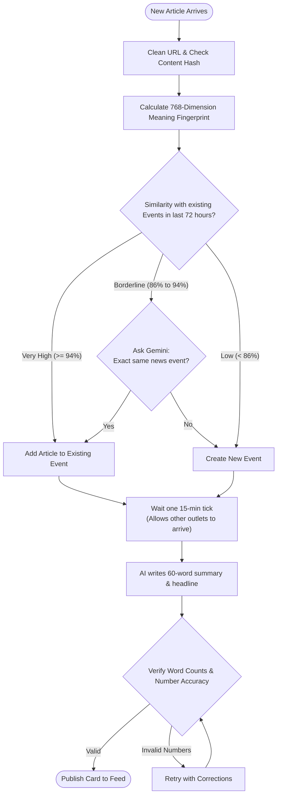
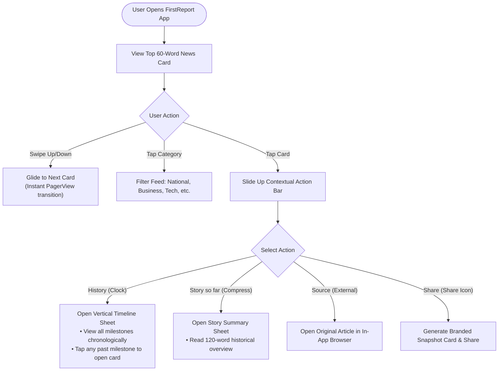

# FirstReport — Project Guide & Feature Walkthrough

FirstReport is a clean, mobile-first Indian news application inspired by the fast, 60-word reading style of Inshorts. It automatically reads thousands of news articles published across India's top newspapers, brings together multiple reports about the same news event into **one concise 60-word card**, and connects related events over time into an easy-to-explore **Story Timeline**.

This guide explains how the entire project works in plain, simple language, walks through each feature, shows visual flowcharts of the user experience, and illustrates the entire process with a concrete, real-world example from start to finish.

---

## Table of Contents

1. [What is FirstReport?](#1-what-is-firstreport)
2. [The Big Picture: How the App Works](#2-the-big-picture-how-the-app-works)
3. [App Features Explained](#3-app-features-explained)
   - [Full-Screen 60-Word News Cards](#full-screen-60-word-news-cards)
   - [Smooth Vertical Feed & Categories](#smooth-vertical-feed--categories)
   - [Daily Progress Tracker](#daily-progress-tracker)
   - [Multi-Publisher Attribution & Logo Badges](#multi-publisher-attribution--logo-badges)
   - [Story Timeline ("History")](#story-timeline-history)
   - ["Story So Far" Executive Summary](#story-so-far-executive-summary)
   - [One-Tap Original Source Verification](#one-tap-original-source-verification)
   - [Branded Visual Card Sharing](#branded-visual-card-sharing)
   - [Smart Freshness Reset](#smart-freshness-reset)
4. [Step-by-Step Walkthrough with a Real-World Example](#4-step-by-step-walkthrough-with-a-real-world-example)
   - [Phase 1: News Breaks (Ingestion & Grouping)](#phase-1-news-breaks-ingestion--grouping)
   - [Phase 2: Writing & Verifying the News Card](#phase-2-writing--verifying-the-news-card)
   - [Phase 3: The Reader's Mobile Experience](#phase-3-the-readers-mobile-experience)
   - [Phase 4: Days Later, a New Development Arrives](#phase-4-days-later-a-new-development-arrives)
   - [Phase 5: Exploring the Story Timeline](#phase-5-exploring-the-story-timeline)
5. [Visual Flowcharts](#5-visual-flowcharts)
   - [Full System Workflow](#full-system-workflow)
   - [News Grouping & Card Publishing Logic](#news-grouping--card-publishing-logic)
   - [Mobile Reading & Timeline Interaction](#mobile-reading--timeline-interaction)
6. [Technology Stack Explained Simply](#6-technology-stack-explained-simply)
7. [Self-Healing Maintenance & Cost Protections](#7-self-healing-maintenance--cost-protections)

---

## 1. What is FirstReport?

When a big news story breaks in India, dozens of outlets (such as _The Hindu_, _Indian Express_, _NDTV_, and _Hindustan Times_) write separate articles about it. Readers are often forced to jump between repetitive websites full of advertisements, long paragraphs, and clutter.

FirstReport solves this with three simple ideas:

1. **Combine multiple reports into one card**: Instead of showing you 10 separate articles about the same press conference or launch, FirstReport combines them into a single, comprehensive news card.
2. **Strict 60-word limit**: Every card is synthesized into an objective, factual summary of at most 60 words, paired with a headline under 12 words. You get all the essential facts in 15 seconds.
3. **Follow the story over time**: News rarely ends in one day. When a story develops over weeks or months, FirstReport chains these events together, giving you an interactive **Timeline** and a **"Story So Far"** summary at any point.

---

## 2. The Big Picture: How the App Works

The entire project operates as a continuous, automated cycle:

```
[ Top Indian News Feeds ]
           │
           │  1. Every 15 minutes, automated workers scan RSS feeds
           ▼
[ Article Ingestion & Cleaning ]
           │  • Remove tracking links & advertisements
           │  • Create mathematical meaning fingerprints (embeddings)
           ▼
[ Grouping Articles into Events ]
           │  • Do multiple outlets report the same happening?
           │  • If yes, combine them into one Event
           ▼
[ AI Card Writing & Verification ]
           │  • Write a crisp 60-word summary from the combined sources
           │  • Verify that every single number and fact is accurate
           ▼
[ Timeline & Story Chaining ]
           │  • Link this event to past events in the same story
           │  • Update a rolling 120-word "Story So Far" summary
           ▼
[ Fastify Public API & Mobile App ]
              • Mobile app loads instant, full-screen vertical cards
              • Readers can tap to open Timelines, Summaries, and Sources
```

---

## 3. App Features Explained

### Full-Screen 60-Word News Cards

Every news event is presented as a clean, full-screen visual card. The top half shows crisp photography directly credited to the news outlet that published it. The bottom half displays the headline and a 60-word summary packed with verified facts. There are no distractions, no banners, and no clickbait headlines.

### Smooth Vertical Feed & Categories

Readers swipe up and down to glide between news cards, exactly like short-form video apps or Inshorts. Swiping is instantaneous and native. A category strip across the top lets you filter between:

- **Top Stories** (all categories)
- **National & Politics**
- **Business & Economy**
- **Technology**
- **Sports**
- **Entertainment**
- **World**

### Daily Progress Tracker

Directly beneath the card's photograph sits an elegant 2-pixel progress bar. As you swipe through the feed, this track visually fills up, showing how many stories you have read out of the day's total in that category (for example, _"Story 4 of 18"_). It gives you a clear sense of completion when you are caught up with the day's news.

### Multi-Publisher Attribution & Logo Badges

Beside the timestamp (e.g., _"35m ago"_), each card features an overlapping stack of publisher icons (favicons) from the outlets that covered the story.

- Seeing badges from _The Hindu_, _Indian Express_, and _NDTV_ together tells you at a glance that the event has been independently reported and verified by multiple major newsrooms.
- Tapping on a logo stack displays all participating publications.

### Story Timeline ("History")

News stories often unfold over days or weeks. When an event is part of a continuing story, tapping on the card reveals a bottom toolbar containing a **History** button.

- Tapping **History** slides up a vertical timeline showing every key milestone in that story from oldest to newest.
- The card you are currently reading is highlighted with a green dot and marked _"Reading now"_.
- Tapping any previous milestone in the timeline immediately opens that past event card as a modal window, letting you review what happened earlier without losing your place.

### "Story So Far" Executive Summary

If you come across a complex news story midway through its development, you do not need to read dozens of past articles to catch up.

- Tapping **Story so far** in the toolbar opens a concise ~120-word chronological briefing.
- This summary explains the story's complete narrative arc up to the specific date of the card you are reading, giving you instant context.

### One-Tap Original Source Verification

Transparency is central to FirstReport. If you want to read the complete original long-form report, tapping **Source** opens the publisher's official article inside an in-app browser view.

### Branded Visual Card Sharing

Want to share news with friends on WhatsApp, Instagram, or Twitter/X? Tapping **Share** instantly captures an offscreen, beautifully styled snapshot card featuring the headline, the verified 60-word summary, date, category, and FirstReport branding, and opens your phone's native sharing menu.

### Smart Freshness Reset

If you leave the app and return after 10 or more minutes, the app automatically resets you to the top of the feed so you immediately see the latest breaking news rather than stale cards from earlier in the day.

---

## 4. Step-by-Step Walkthrough with a Real-World Example

To see how all the technical pieces and features fit together, let us follow a single real-world news story from the moment it breaks to the moment a reader interacts with it.

---

### Scenario: ISRO Launches a New Solar Observatory Mission

#### Phase 1: News Breaks (Ingestion & Grouping)

- **10:00 AM — Outlets Publish**:
  - _The Hindu_ publishes: _"ISRO successfully launches Aditya solar probe from Sriharikota aboard PSLV-C57 rocket."_
  - _NDTV_ publishes: _"India's first space-based solar observatory lifts off on a 1.5 million km journey."_
  - _Indian Express_ publishes: _"Aditya launch: PSLV rocket places solar satellite into Earth orbit."_
- **10:15 AM — Worker Tick Runs**:
  1. The automated worker performs an HTTP check on the RSS feeds. Because new articles exist, it downloads them.
  2. **URL Cleanup**: It strips tracking codes (`utm_source`, `ref`) so links are clean and unique.
  3. **Readability & Hashing**: It extracts the opening paragraphs (~120 words) and generates a SHA-256 fingerprint to ensure exact duplicates are never processed twice.
  4. **Meaning Vector (Embedding)**: Google Gemini converts the headline and text into a 768-dimensional numerical fingerprint that captures its semantic meaning.
  5. **Grouping into an Event**: The system compares this fingerprint against other news from the last 72 hours. It detects that the articles from _The Hindu_, _NDTV_, and _Indian Express_ have a 96% similarity score (above the 94% threshold).
  6. Instead of creating 3 separate news items, it joins them into a single **Event** and calculates a shared center point for the story.

#### Phase 2: Writing & Verifying the News Card

- **10:30 AM — One-Tick Maturation**:
  - The Event waits one 15-minute cycle so reports from all outlets have time to arrive.
- **Card Generation**:
  - The worker passes the combined text from all 3 outlets to Google Gemini Flash-Lite.
  - Gemini writes a headline and a 60-word summary:
    > **Headline**: ISRO Launches Aditya Solar Observatory Aboard PSLV-C57 Rocket  
    > **Summary**: The Indian Space Research Organisation has successfully launched the Aditya spacecraft from Sriharikota. Carried by the PSLV-C57 rocket, the 1,500-kilogram satellite has entered Earth orbit before commencing its four-month journey to the L1 Lagrange point, 1.5 million kilometers away, to study solar activity and space weather.
- **Strict Code Validation**:
  - The system checks the summary:
    - Word count: 52 words (passes the $\le 60$ words limit).
    - Headline: 8 words (passes the $\le 12$ words limit).
    - **Number Verification**: The system checks every number ("PSLV-C57", "1,500", "1.5 million"). Because all these numbers appear in the source articles, it is validated and marked **Published**.
- **Story Creation**:
  - The system creates a new narrative story titled `#AdityaSolarMission`.

#### Phase 3: The Reader's Mobile Experience

- **10:35 AM — A User Opens FirstReport**:
  1. The user launches the app. The Aditya mission appears as the top card.
  2. The card shows a photograph of the rocket launch with a credit chip (_"Photo: The Hindu"_).
  3. The 2-pixel daily progress bar shows _"Story 1 of 14"_ in National news.
  4. Beside the timestamp (_"20m ago"_), 3 overlapping circular logos show _The Hindu_, _NDTV_, and _Indian Express_.
  5. The user reads the 52-word summary in 15 seconds.
  6. The user swipes up to continue reading other stories.

#### Phase 4: Days Later, a New Development Arrives

- **Day 5, 2:00 PM — The Satellite Executes a Major Orbit Burn**:
  - Outlets report that the satellite has performed a key propulsion burn to leave Earth orbit.
  - The worker ingests these new reports, creates a new Event card, and calculates its meaning fingerprint.
  - The system compares this new Event with existing Stories from the last 30 days. It sees a strong match with `#AdityaSolarMission`.
  - It links the new Event into the existing Story.
  - It automatically prompts Gemini to synthesize an updated, chronological **"Story So Far"** summary (~120 words) that connects the initial launch to this new orbit burn.

#### Phase 5: Exploring the Story Timeline

- **Day 5, 2:30 PM — The Reader Sees the New Update**:
  1. The user sees the new card: _"Aditya Satellite Successfully Leaves Earth Orbit Towards Sun"_.
  2. The user taps the card to reveal the action bar at the bottom.
  3. The user taps **History (2)**:
     - A clean bottom sheet slides up showing a vertical timeline:
       - **Nov 15**: _ISRO Launches Aditya Solar Observatory Aboard PSLV-C57 Rocket_
       - **Nov 20**: _Aditya Satellite Successfully Leaves Earth Orbit Towards Sun_ · **Reading now**
     - The user taps the Nov 15 entry. The original launch card opens immediately in a modal view! They refresh their memory, close the modal, and are back immediately on today's card.
  4. The user taps **Story so far**:
     - A 120-word summary explains how the mission started at Sriharikota, spent 5 days in Earth orbit, and has now commenced its cruise to the L1 point.
  5. The user taps **Share**:
     - The app renders an image card and sends it to their family chat on WhatsApp.

---

## 5. Visual Flowcharts

### Full System Workflow



---

### News Grouping & Card Publishing Logic



---

### Mobile Reading & Timeline Interaction



---

## 6. Technology Stack Explained Simply

Each tool in FirstReport was chosen to be reliable, fast, and cost-effective:

| Technology                  | What it is               | Why it is used in FirstReport                                                                                                                           |
| :-------------------------- | :----------------------- | :------------------------------------------------------------------------------------------------------------------------------------------------------ |
| **React Native & Expo**     | Mobile framework         | Allows building a smooth, native app for Android and iOS using one codebase.                                                                            |
| **react-native-pager-view** | Native swiping engine    | Powers the seamless, vertical full-screen card swiping.                                                                                                 |
| **react-native-reanimated** | Animation library        | Drives fluid 60fps animations for the progress bar, action toolbar, and bottom sheets.                                                                  |
| **TanStack React Query**    | Data fetching tool       | Caches news cards locally, downloads upcoming pages, and handles instant loading.                                                                       |
| **Fastify**                 | High-speed web server    | Serves news cards to phones in milliseconds with very low server memory usage.                                                                          |
| **PostgreSQL 16**           | Relational database      | The rock-solid data store holding all articles, events, stories, and audit logs.                                                                        |
| **pgvector**                | Vector search extension  | Allows Postgres to compare meaning fingerprints directly using fast cosine distance, eliminating the need for an expensive third-party vector database. |
| **Drizzle ORM**             | Database toolkit         | Provides clean, type-safe database queries and automated schema migrations.                                                                             |
| **pg-boss**                 | Background job scheduler | Runs the 15-minute ingestion pipeline and nightly cleanup jobs reliably using Postgres.                                                                 |
| **Google Gemini AI**        | Artificial Intelligence  | `gemini-embedding-2` creates meaning fingerprints, and `gemini-3.1-flash-lite` writes the 60-word summaries and story timelines.                        |
| **Mozilla Readability**     | Web article extractor    | Pulls clean article text from newspaper web pages when RSS descriptions are too brief.                                                                  |
| **Docker & Compose**        | Containerization         | Packages the database, worker, and API so the entire backend runs easily on any server.                                                                 |

---

## 7. Self-Healing Maintenance & Cost Protections

FirstReport is designed to run automatically without needing constant developer attention or expensive cloud bills:

### Nightly Maintenance (Runs Daily at 02:30 IST)

1. **Twin Merging**: If two separate events from different outlets turn out to be about the exact same story (similarity $\ge 94\%$), the nightly job automatically merges them into one, keeping the live card and linking all articles together.
2. **Database Clean-Up**: Full article bodies are purged after 14 days, keeping only the headlines, summaries, and fingerprints. This keeps the database lean and speedy.
3. **Story Dormancy**: If a story receives no new updates for 30 consecutive days, it is marked _dormant_ so the system focuses searches on currently active news.

### Automated Budget Brakes

Every single AI call records its token count and cost in the `llm_calls` database table. The system enforces strict daily spending caps:

- **Soft Brake (\$1.50 per day)**: If AI usage reaches \$1.50 in a day, the system skips optional rewrites, keeping the budget low while continuing to publish all new news cards.
- **Hard Brake (\$3.00 per day)**: If daily usage crosses \$3.00, AI generation pauses and alerts the developer, ensuring costs never exceed \$20–\$40 a month.
